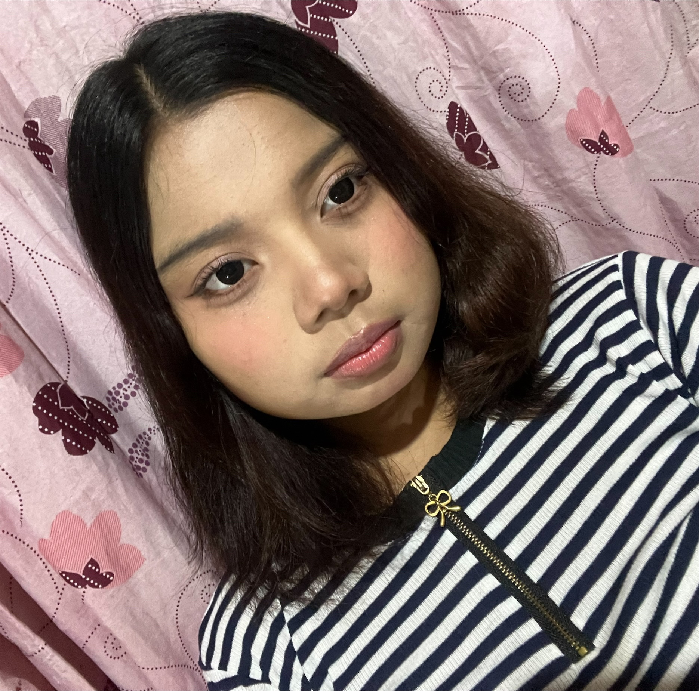

 

 
# ꧁⎝ 𓆩༺✧༻𓆪 ⎠꧂
# ʜɪ, ɪ'ᴍ ᴀʀɪᴀɴɴᴇ!
### ˚₊•꒰১ ꜱᴛᴜᴅᴇɴᴛ ᴅᴇᴠᴇʟᴏᴘᴇʀ ・ ʟᴇᴀʀɴɪɴɢ ꜱᴏᴍᴇᴛʜɪɴɢ ɴᴇᴡ ᴇᴠᴇʀʏ ᴅᴀʏ ໒꒱ •₊
 
 

 
 
 
 
 
[☆ ᴀʙᴏᴜᴛ](#about) ・ [☆ ꜱᴋɪʟʟꜱ](#skills) ・ [☆ ᴘʀᴏᴊᴇᴄᴛꜱ](#projects) ・ [☆ ꜱᴏᴄɪᴀʟꜱ](#socials)
 

 

## ᛝ ᴀʙᴏᴜᴛ ᴍᴇ

 
Hi! I'm **Arianne Pelayo**, a **First-year BSIT** student at **National University Clark**.
A beginner who's still learning along the way, hoping to build greater projects in the future.
I love incorporating my own ideas into code to give it some personal touch ♡

ᯓ★ **Favorites:** Pierce the Veil ♡ Paradise Kiss ♡ Caramel Sundae
#### **♡** i love cats

‿̩͙⊱༒︎༻♱༺༒︎⊰‿̩͙

 
 

## ⡞⠳⣄⣀⣠⠞⢷ ֹ۪

<pre>
⠀⠀⠀⠀⠀⠀⠀⠀⠀⠀⠀⠀⠀⠀⠀⠀⠀⠀⠀⠀⠀⠀⠀⠀⠀⠀⠀⠀⠀⠀⠀⠀⠀⠀⠀⠀⠀⠀⠀⠀⠀⠀⠀⠀⠀⠀⠀⠀⠀⠀⠀⠀⠀⠀⠀⠀
⠀⠀⠀⠀⠀⠀⠀⠀⠀⠀⠀⠀⠀⠀⠀⠀⠀⠀⠀⠀⠀⠀⠀⢀⡾⠍⠙⣧⠀⠀⠀⠀⠀⠀⠀⠀⠀⠀⠀⠀⠀⠀⠀⠀⠀⠀⠀⠀⠀⠀
⠀⠀⠀⠀⠀⠀⠀⠀⠀⠀⠀⠀⠀⠀⠀⠀⠀⠀⠀⠀⠀⠀⢀⡾⠁⠀⠀⠘⣷⠀⠀⠀⠀⠀⠀⠀⠀⠀⠀⠀⠀⠀⠀⠀⠀⠀⠀⠀⠀⠀
⠀⠀⠀⠀⠀⠀⠀⠀⠀⠀⠀⠀⠀⠀⠀⠀⠀⢀⣀⣀⣠⣤⡾⠁⠀⠀⠀⠀⠘⣧⣄⣀⣀⣀⠀⠀⠀⠀⠀⠀⠀⠀⠀⠀⠀⠀⠀⠀⠀⠀
⠀⠀⠀⣠⡶⠶⣦⡀⠀⠀⠀⠀⠀⠀⠀⢰⡿⠉⠉⠉⠀⠀⠀⠀⠀⠀⠀⠀⠀⠀⠀⠈⠉⠉⠉⢳⡆⠀⠀⠀⠀⠀⠀⠀⣀⣴⠶⢶⣄⠀
⠀⠀⠀⣿⠀⠀⠀⠙⢷⣄⡀⠀⠀⠀⠀⠘⢷⣄⠀⠀⠀⠀⠀⠀⠀⠀⠀⠀⠀⠀⠀⠀⠀⠀⣠⠞⠁⠀⠀⠀⠀⢀⣠⠾⠋⠀⠀⢀⣿⠂
⠀⠀⠀⠙⣷⣄⠀⠀⠀⠈⠙⠳⢦⣤⣄⣀⠀⠙⢷⣄⠀⠀⠀⠀⠀⠀⠀⠀⠀⠀⠀⠀⣠⠞⠁⠀⣀⣠⣤⠶⠞⠋⠁⠀⠀⠀⣠⣾⠁⠀
⠀⠀⠀⢸⡇⠉⠳⠶⡄⠀⠀⠀⠀⠀⠈⢙⠻⣦⠀⢸⡇⠀⠀⠀⠀⠀⠀⠀⠀⠀⠀⢸⡏⢀⣴⠟⠉⠀⠀⠀⠀⠀⠀⢠⠶⠛⠉⣸⠇⠀
⠀⠀⠀⠀⠙⠶⣤⣄⣀⠀⠀⠀⠀⣰⠟⠋⠀⢸⡇⣾⠀⠀⠀⠀⠀⠀⠀⠀⠀⠀⠀⠘⣧⢸⡇⠀⠛⢻⡆⠀⠀⠀⢀⣄⣠⣤⠾⠋⠀⠀
⠀⠀⠀⠀⠀⠀⠻⣤⣀⣀⣀⣀⡀⠹⣦⣀⣠⡾⢁⡟⠀⠀⠀⣀⣤⠾⠶⣤⣀⠀⠀⠀⣿⠘⢷⣄⣀⣴⠇⢀⣀⣀⣀⣁⣴⠟⠀⠀⠀⠀
⠀⠀⠀⠀⠀⠀⠀⠈⠉⠉⠻⢧⡤⠴⠞⠋⠀⠀⠀⠳⠤⠶⠛⠉⠀⠀⠀⠀⠉⠛⠶⠴⠟⠁⠀⠈⠙⠳⠦⣤⠽⠟⠉⠉⠀⠀⠀⠀⠀⠀
⠀⠀⠀⠀⠀⠀⠀⠀⠀⠀⠀⠀⠀⠀⠀⠀⠀⠀⠀⠀⠀⠀⠀⠀⠀⠀⠀⠀⠀⠀
</pre>

### ⋆ ᴄᴜʀʀᴇɴᴛʟʏ ʟᴇᴀʀɴɪɴɢ
- 𑄝੭ Java programming
 
### ⋆ ᴍʏ ɢᴏᴀʟꜱ
- 𑄝੭ Build projects I'm proud of
- 𑄝੭ Get better at problem solving
- 𑄝੭ Secure a job 
 
> .☘︎ ݁˖"Small steps every day make big dreams come true."˖☘︎.
 

‿̩͙⊱༒︎༻♱༺༒︎⊰‿̩͙

 

## ᛝ ᴍʏ ꜱᴋɪʟʟꜱ
 
 
 

 
 
 
 

 
 
 
 

 
 
 

‿̩͙⊱༒︎༻♱༺༒︎⊰‿̩͙

 

## ᛝ ᴍʏ ᴘʀᴏᴊᴇᴄᴛꜱ
 
### ⋆ ᴍɪᴅᴛᴇʀᴍꜱ
#### ࣪ ִֶָ☾. [Lab Task 1](https://github.com/pelayoarianne/Programming-26/blob/main/Pelayo_LabTask1.pdf) ・ *Two-dim Array*
#### ࣪ ִֶָ☾. [Lab Task 2](https://github.com/pelayoarianne/Programming-26/blob/main/Pelayo_LabTask2.pdf) ・ *Three-dim Array*
 

‿̩͙⊱༒︎༻♱༺༒︎⊰‿̩͙

 

 
## ᛝ ꜱᴏᴄɪᴀʟꜱ
 
<table>
  <tr>
    <td align="center">
      
    </td>
    <td align="center">
      
    </td>
  </tr>
  <tr>
    <td align="center">
      
    </td>
    <td align="center">
      
    </td>
  </tr>
</table>
 
 
 
₊˚ ʚ ᴛʜᴀɴᴋꜱ ꜰᴏʀ ᴠɪꜱɪᴛɪɴɢ ɞ ˚₊
 

 

 

 
